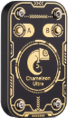

<p align="center">
  
</p>

<h1 align="center">ChameLab</h1>

<p align="center">
  Desktop, mobile and web app for ChameleonUltra and ChameleonLite,<br>
  together with an extended firmware and the command line client.
</p>

<p align="center">
  <a href="https://m0n5ter.github.io/ChameLab/"><b>Open in the browser</b></a> ·
  <a href="https://m0n5ter.github.io/ChameLab/#stable">Download</a> ·
  <a href="CHANGELOG.md">Changelog</a>
</p>

## The app

One app for Windows, macOS, Linux, Android, iOS and the browser. USB on desktop and in
the browser, Bluetooth on phones and in Chrome / Edge, TCP everywhere.

- **Slots** — all eight slots at a glance, with each card's name and LED color. Drag to
  reorder, tap to activate, edit HF and LF separately.
- **Read and dump** — ISO14443-A and LF scans. MIFARE Classic Mini, 1K and 4K dumps with
  your key dictionaries, edited as hex and emulated in one tap.
- **Saved cards** — a card library with search and color tags. Imports
  ChameleonUltraGUI, Proxmark3, Flipper `.nfc` / `.rfid`, MCT, `.bin` and `.eml`.
- **Cloning** — write LF IDs to T55xx and MIFARE Classic to Gen1a / Gen2 magic cards.
- **Emulator settings** — Gen1a / Gen2 modes, write modes, nonce detection for mfkey32,
  Ultralight / NTAG version, signature and counters.
- **LF sniffing** — record the 125 kHz signal at the antenna, see it as a zoomable
  waveform with a modulation and clock guess, and decode it as Manchester. Captures
  load and save as raw `.bin`, the same as the CLI's `lf sniff --out`.
- **Device settings** — LED animation, button actions, long-press threshold, sleep
  timeout, BLE pairing, factory reset and firmware updates over USB or Bluetooth.

Key recovery includes Darkside, Nested, Static nested and mfkey32, plus the
original native Hardnested solver on desktop. Hardnested needs a known key and
substantial memory; mobile and browser builds show a resource-requirements warning.

Not there yet: HF sniffing, editing slot data in place, backdoor key recovery,
QR sharing and translations. The full list is in the
[roadmap](software/chamelab/ROADMAP.md).

The web version needs Chrome or Edge: Firefox and Safari support neither Web Serial nor
Web Bluetooth.

Sources, architecture and build steps: [software/chamelab](software/chamelab).

## The firmware

The ChameLab firmware runs on both ChameleonUltra and ChameleonLite and moves together
with the app: features are added on both sides and shipped in the same release.

- **Slot LED colors** — each card in a slot can have its own LED color, so you can tell
  which card is active by looking at the device. A slot that holds both an HF and an LF
  card alternates between their two colors.
- **Fixes** — for example, saving no longer fails after many slot switches.

The full list is on the [website](https://m0n5ter.github.io/ChameLab/#firmware) and in
the [changelog](CHANGELOG.md).

### Updating

The app on desktop, Android and iOS updates the firmware for you: it offers the newest
release for your device and flashes it over USB or Bluetooth. To flash by hand:

1. Download `ultra-dfu-app-<version>.zip` or `lite-dfu-app-<version>.zip` from the
   [releases](https://github.com/m0n5ter/ChameLab/releases). The `-full` packages also
   contain the bootloader and are only needed for recovery.
2. Put the device into DFU mode: `hw dfu` in the CLI, or hold button B while plugging in
   USB.
3. Flash the package with [`firmware/flash-dfu-app.sh`](firmware/flash-dfu-app.sh),
   nRF Connect for mobile or nRF Connect for Desktop.

Slots, cards and settings are kept by an application update.

### Building

```bash
cd firmware
docker compose up --pull=always build-ultra
```

Use `build-lite` for the ChameleonLite. The packages land in `firmware/objects/`.

## The CLI

The Python command line client lives in [software/script](software/script) and is
managed with [uv](https://docs.astral.sh/uv/):

```bash
cd software
uv run script/chameleon_cli_main.py
```

It covers what the app does not have yet, such as HF sniffing, and every firmware
command, for example `hw slot color`.

## Versions

Releases are tagged with the ChameLab version (`v1.0.8`), which goes up with every
release. The firmware has its own version in [`firmware/VERSION`](firmware/VERSION)
(`2.3.2-cl`) and changes only when the firmware does.

## Repository

| Folder | What's in it |
| --- | --- |
| [`software/chamelab`](software/chamelab) | The ChameLab app (Avalonia, .NET) |
| [`software/script`](software/script) | The Python CLI |
| [`firmware`](firmware) | Application and bootloader firmware for nRF52840 |
| [`hardware`](hardware) | Schematics and PCB files for Ultra and Lite |
| [`website`](website) | The download page and the web app host |

## License

Free software under the [GNU GPL v3](LICENSE).
